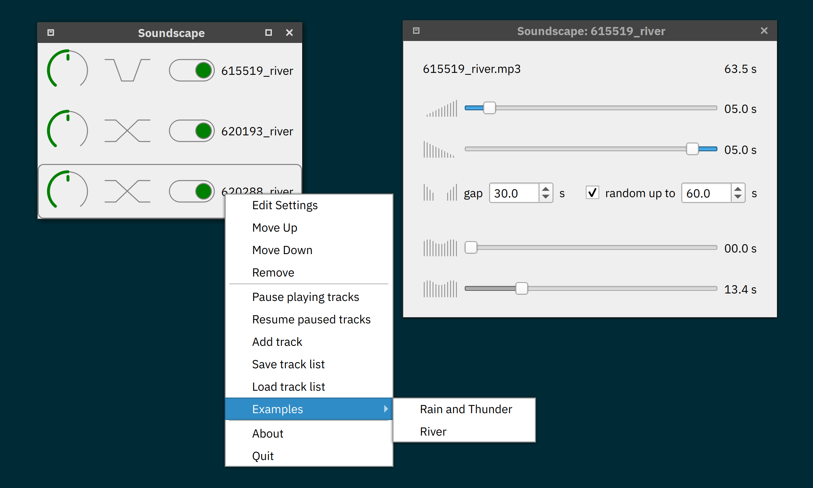
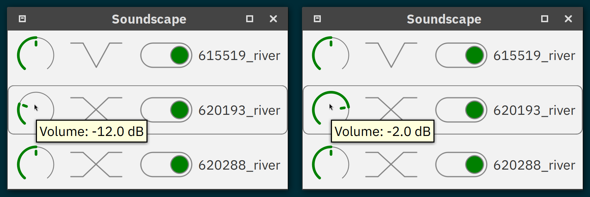
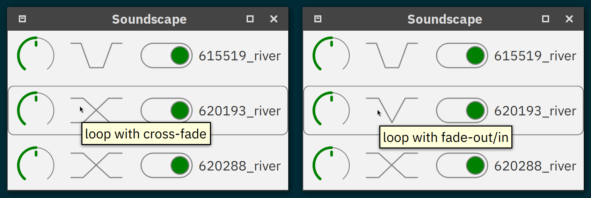
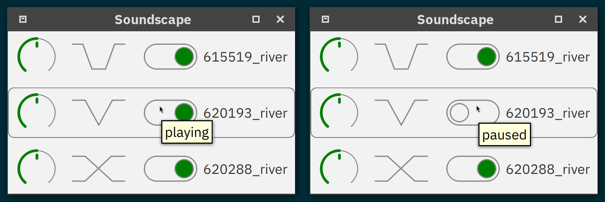
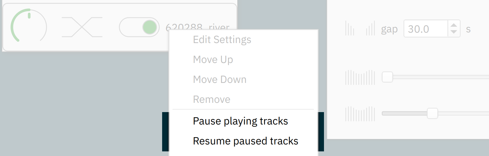

# Soundscape

[**Soundscape**](https://github.com/ddanilov/soundscape) is an open-source
desktop application that runs in the system tray and plays a mix of sounds,
such as animal, wind, and water sounds.

## Usage

The application comes with two example soundscapes. Right-click the main window
or tray icon to open the application menu, where you can add or remove
soundtracks and change their settings.

For each track, you can change its volume, loop transition, and playback state.

### Volume

### Loop transition

For transition with gap you can specify the gap length in track settings. In
addition, you can also configure the gap length to be chosen randomly each time
between left and right number of seconds (see `random up to` check box).

### Playback

From the application menu you can pause and resume all tracks at once.

On Linux and Windows, use the `Quit` item from the application menu to finish
the application. Pressing the close window button will just minimize the
application to the tray.

### Command line options

* `--load <path to file>` load track list from a file on start,
* `--minimize` minimize window to tray on start,
* `--disable-tray` disable tray icon,
* `--single-instance` prevent starting multiple instances.

### More sounds
[Freesound](https://freesound.org/) is a good source of sounds for your own
soundscapes.

## Installation

### Linux distributions

Packages for some Linux distributions are available.

**Ubuntu** users can install the application from the PPA repository
`ppa:ddanilov/soundscape`, see
<https://launchpad.net/~ddanilov/+archive/ubuntu/soundscape> for
details.

**Debian**, **openSUSE** and **Fedora** packages can be installed from
the download page for the `home:danilov:soundscape` OBS project, see
<https://software.opensuse.org/download/package?package=soundscape&project=home:danilov:soundscape>.

**Flatpak** package is available from the **Flathub** app store at
<https://flathub.org/apps/io.github.ddanilov.soundscape>.

### Windows

You can install the application using **Windows Package Manager**

    winget search soundscape
    winget install Danilov.Soundscape

### Prebuilt binaries

Prebuilt binaries for Windows, macOS and Linux are available from the
[Releases page](https://github.com/ddanilov/soundscape/releases).

On Linux, you may need to install an additional package to run the prebuilt binary.
Most likely XCB util-cursor module is missing. On Debian-based systems,
install it with

    sudo apt-get install libxcb-cursor0

on openSUSE with

    sudo zypper install libxcb-cursor0

and on RedHat-based systems with

    sudo dnf install xcb-util-cursor

## Build from source

Building from source requires Qt, CMake, and C++17 compiler. On macOS, install `librsvg` (with `brew install librsvg`)
which is required to generate the application icon.

Build the project with CMake:

    cmake -DCMAKE_BUILD_TYPE=Release -S <path-to-source> -B <path-to-build>
    cmake --build <path-to-build>

Run the test suite with:

    ctest --test-dir <path-to-build>/tests --output-on-failure

If CMake cannot find Qt, add `-DCMAKE_PREFIX_PATH=/path/to/Qt` to the configure command, using the directory for your
installed Qt kit.

### CMake options

All project-specific options are disabled by default. Enable an option by
adding `-D<OPTION>=ON` to the CMake configure command.

| Option               | Description                                                                                                                                         |
|----------------------|-----------------------------------------------------------------------------------------------------------------------------------------------------|
| `WITH_CLANG_FORMAT`  | run `clang-format --dry-run --Werror` while compiling, if `clang-format` is available.                                                              |
| `WITH_COVERAGE`      | add coverage instrumentation to the tests and provide the `coverage` and `coveralls` build targets. Requires `gcovr` and `Debug` build.             |
| `WITH_DEPLOY_SCRIPT` | generate a Qt deployment script and enable CPack packaging: ZIP and, when NSIS is available, NSIS on Windows; DragNDrop on macOS; and TGZ on Linux. |

For example, generate an HTML coverage report in `<path-to-build>/coverage` with:

    cmake -DCMAKE_BUILD_TYPE=Debug -DWITH_COVERAGE=ON -S <path-to-source> -B <path-to-build>
    cmake --build <path-to-build>
    ctest --test-dir <path-to-build>/tests --output-on-failure
    cmake --build <path-to-build> --target coverage

## License

This program is free software: you can redistribute it and/or modify
it under the terms of the GNU General Public License version 3 as
published by the Free Software Foundation.

This program is distributed in the hope that it will be useful, but
WITHOUT ANY WARRANTY; without even the implied warranty of
MERCHANTABILITY or FITNESS FOR A PARTICULAR PURPOSE. See the GNU
General Public License for more details.

You should have received a copy of the GNU General Public License
along with this program. If not, see <https://www.gnu.org/licenses/>.
